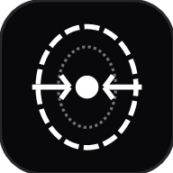

# PressZero — Zero-Knowledge Image Precision Studio

<p align="center">
  
</p>

<p align="center">
  <strong>The client-side, zero-knowledge precision image compressor. Hit exact kilobyte targets for government portals, biometric visas, and passports with zero byte egress.</strong>
</p>

<p align="center">
  <a href="#features">Features</a> •
  <a href="#architecture">Architecture</a> •
  <a href="#security--zero-knowledge">Zero Knowledge</a> •
  <a href="#windows-desktop-app">Windows App</a> •
  <a href="#deployment">Deployment</a> •
  <a href="#quick-start">Quick Start</a>
</p>

---

## ⚡ Why PressZero?

Official portals (UPSC, SSC, US Visa DS-160, Schengen, Passport Seva, EPFO) reject files that miss exact file size constraints (e.g. *Must be between 20 KB and 50 KB*). Traditional compressors only offer vague percentage sliders ("70% quality"), forcing users into frustrating trial-and-error.

**PressZero solves this with an exact binary search bisection algorithm.** Enter `50 KB`, and our WebAssembly/Canvas pipeline calculates the exact mathematical quantization factor to output an image at **49.8 KB**, every single time.

---

## 🔒 Security & Zero-Knowledge Guarantee

```
  User Browser / Desktop
  ┌────────────────────────────────────────────────────────┐
  │  Image Input ──► HTML5 Canvas / Worker ──► Compressed  │
  └──────────────────────────┬─────────────────────────────┘
                             │
                      0 Bytes Egress
                   (No Server Upload)
                             │
                             ▼
                    Protected & Private
```

1. **Zero Bytes Egress**: Images never leave your device. All processing occurs locally via Web Workers and client-side HTML5 Canvas.
2. **Offline Capable**: Works completely disconnected from the internet.
3. **Hardened Headers**: Production deployment enforces strict `Content-Security-Policy` with `connect-src 'self'`.
4. **No Analytics or Telemetry**: No tracking pixels, no third-party cookies, no tracking scripts.

---

## ✨ Features

- **Exact Kilobyte Target (Binary Bisection)**: Quantizes compression levels iteratively using binary search to converge onto your target file size within ±2% tolerance.
- **Biometric Cropping & Presets**: Built-in 2"x2" (US Visa), 3.5x4.5cm (Schengen/Passport), PAN Card, and signature dimension templates.
- **Document Bleaching & Background Normalization**: Whitens shadows, cleans document grain, and normalizes high-contrast thresholding for signature acceptance.
- **Batch Processing**: Drag and drop 50+ images at once; multithreaded processing across CPU cores with real-time progress.
- **Single-Click ZIP Export**: Download all compressed images organized in an archive with original vs. compressed size summaries.
- **Native Windows Desktop App**: Lightweight Windows runner and setup installer (`PressZero-Setup.exe`) for enterprise and offline environments.
- **Progressive Web App (PWA)**: Installable directly to your taskbar or home screen with service worker caching.

---

## 🖥️ Windows Desktop Application

PressZero includes a native Windows standalone release:

- **Installer (`PressZero-Setup.exe`)**: Per-user installer installing to `%LOCALAPPDATA%\Programs\PressZero` with Start Menu & Desktop shortcuts and clean uninstallation.
- **Portable Runner (`PressZero.exe`)**: Standalone binary (no installation required).
- **Offline Bundle (`PressZero-Windows-x64.zip`)**: Complete archive including launcher script and offline dependencies.

Download directly from the `/download` page on the web application.

---

## 🚀 Deployment Guide

### Deploy to Vercel

PressZero is optimized for Next.js 16 and Vercel edge deployment:

[](https://vercel.com/new)

```bash
# Via Vercel CLI
npx vercel
```

Configuration is already pre-configured in `vercel.json`.

### Deploy with Docker

A production multi-stage `Dockerfile` is included:

```bash
# Build Docker image
docker build -t presszero:latest .

# Run container
docker run -p 3000:3000 presszero:latest
```

Open `http://localhost:3000` in your browser.

### Deploy to Netlify

Pre-configured with `netlify.toml` and `@netlify/plugin-nextjs`:

```bash
netlify deploy --prod
```

---

## 🛠️ Quick Start (Local Development)

### Prerequisites

- Node.js 18+ or 20+
- npm or pnpm

### Installation

```bash
# Clone the repository
git clone https://github.com/soumyadeepsarkar-2004/PressZero.git
cd PressZero

# Install dependencies
npm install

# Start development server
npm run dev
```

Visit `http://localhost:3000` to access the application.

### Production Build

```bash
npm run build
npm start
```

---

## 🏛️ Architecture & System Design

```
src/
├── app/
│   ├── api/
│   │   └── health/route.ts       # Health probe & 0-egress telemetry
│   ├── download/page.tsx         # Windows installer & desktop download center
│   ├── studio/page.tsx           # Full-featured compression studio
│   ├── error.tsx                 # Client error boundary
│   ├── not-found.tsx             # 404 handler
│   ├── layout.tsx                # Root layout with CSP & metadata
│   ├── page.tsx                  # Marketing & interactive demo landing page
│   ├── robots.ts                 # Search engine crawling rules
│   └── sitemap.ts                # Dynamic XML sitemap
├── components/
│   ├── BatchQueue.tsx            # Multi-file queue & ZIP archiver
│   ├── CompressorSandbox.tsx     # Live interactive demo
│   ├── HeroVideo.tsx             # Animated canvas product demonstration
│   ├── PressZeroLogo.tsx         # High-precision aperture vector logo
│   └── ...
└── lib/
    ├── bisectCompress.ts         # Binary search kilobyte convergence engine
    └── bleachDocument.ts         # High-pass background whitening filter
```

---

## ⚖️ License

Distributed under the MIT License. See `LICENSE` for more information.
