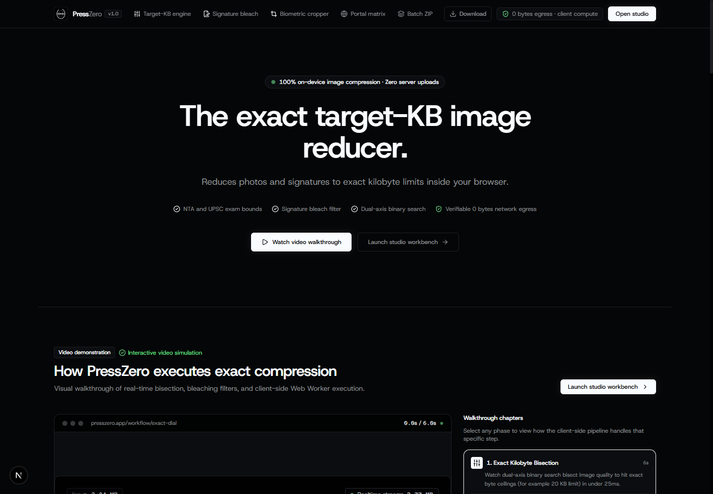
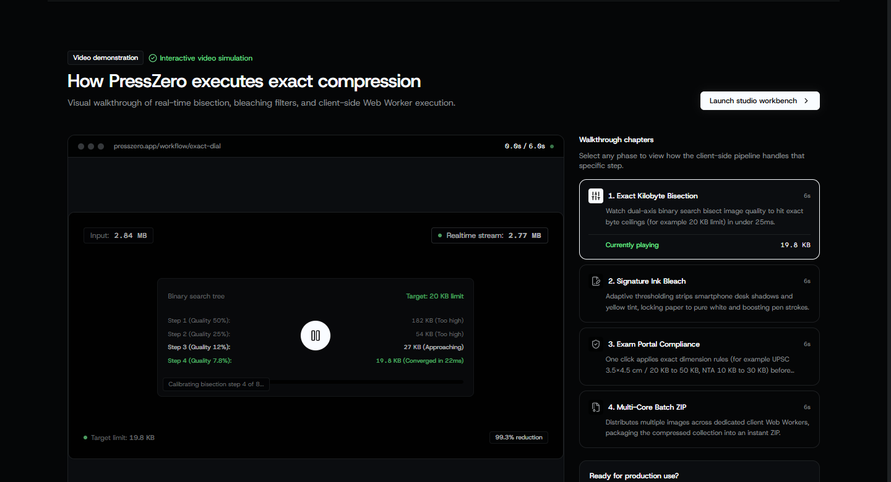
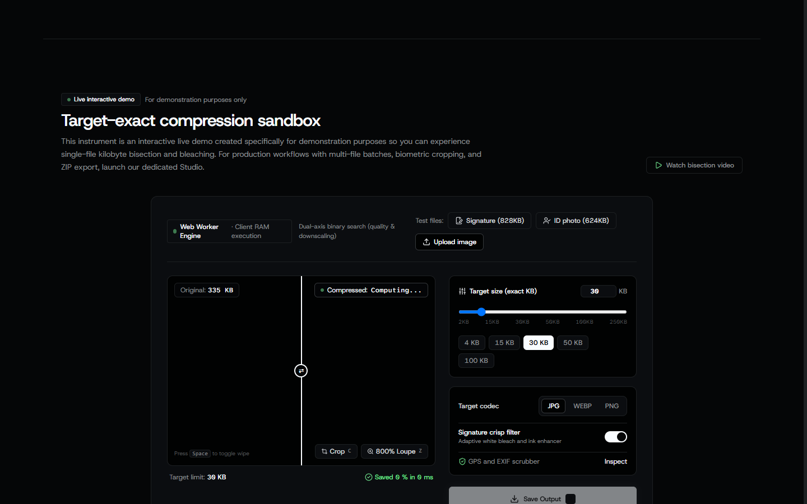
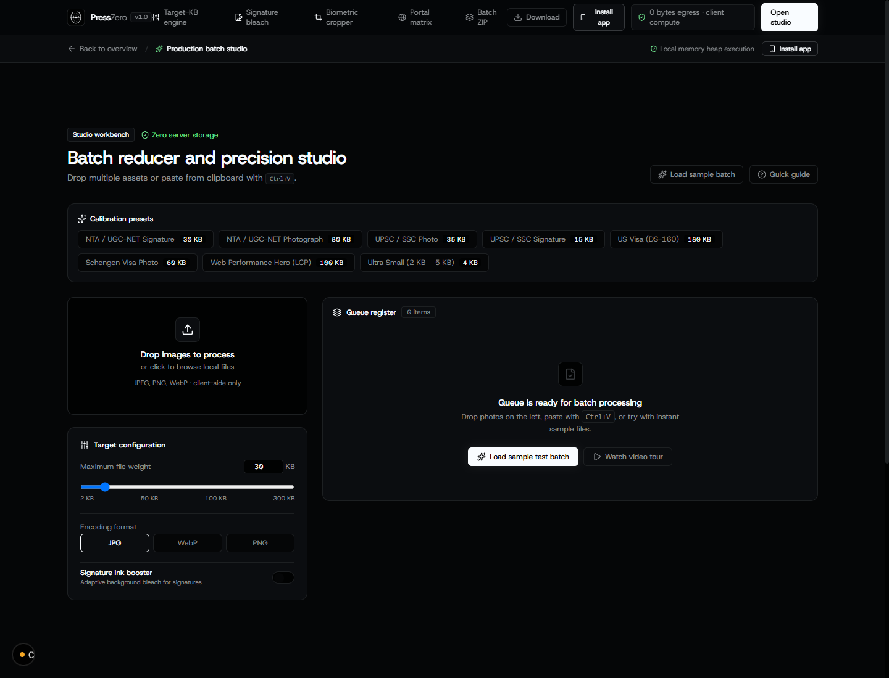
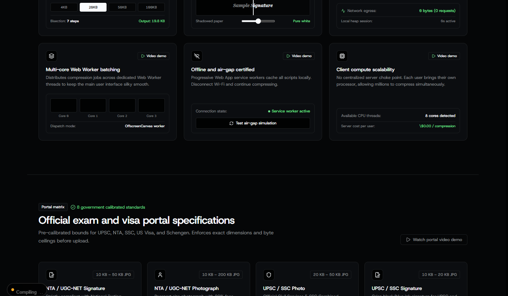
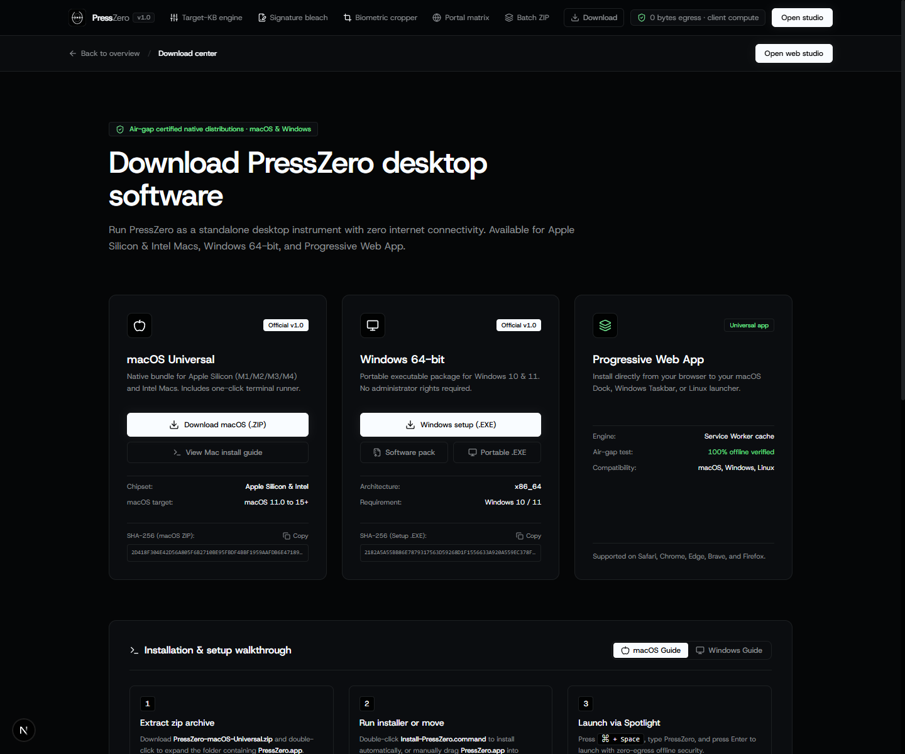
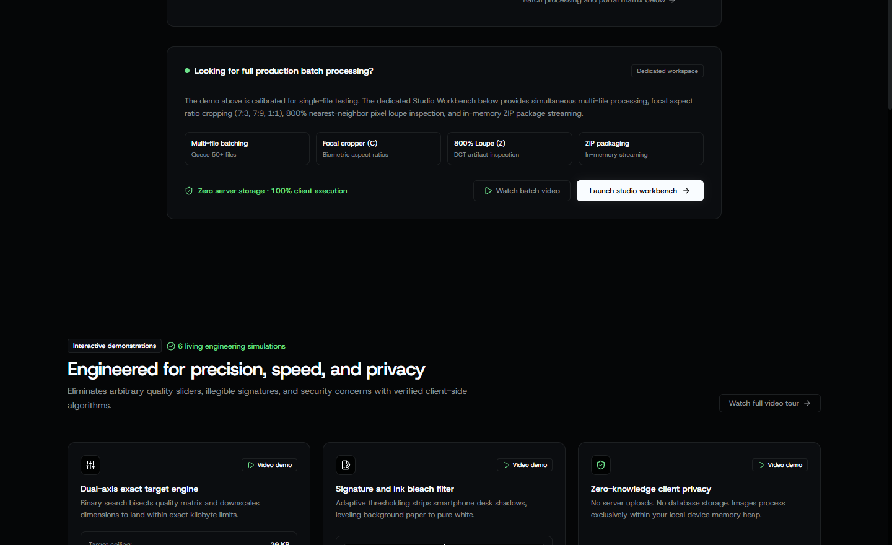
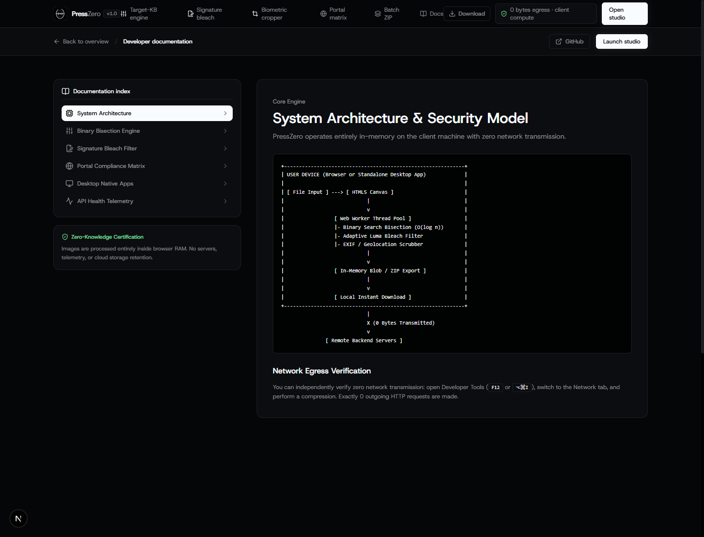

<p align="center">
  
</p>

<h1 align="center">PressZero</h1>

<p align="center">
  <strong>The Client-Side Zero-Knowledge Precision Image Studio</strong><br />
  <em>Hit exact kilobyte ceilings for government exams, biometric visas, and passports with verifiable 0 bytes network egress.</em>
</p>

<p align="center">
  <a href="https://presszero.antideploy.app"></a>
  <a href="https://antideploy.com/app/71272d83-280d-405b-99ba-3844c0ca7116"></a>
  <a href="https://github.com/soumyadeepsarkar-2004/PressZero/actions/workflows/ci.yml"></a>
  <a href="https://github.com/soumyadeepsarkar-2004/PressZero/releases/tag/v1.0.0"></a>
  <a href="#security--zero-knowledge-guarantee"></a>
  <a href="LICENSE"></a>
</p>

<p align="center">
  <a href="https://presszero.antideploy.app"><b>🌐 Live Production Web App</b></a> •
  <a href="https://github.com/soumyadeepsarkar-2004/PressZero/releases/download/v1.0.0/PressZero-macOS-Universal.zip"><b>🍎 Download macOS Universal (.ZIP)</b></a> •
  <a href="https://github.com/soumyadeepsarkar-2004/PressZero/releases/download/v1.0.0/PressZero-Setup.exe"><b>⬇️ Download Windows Setup (.EXE)</b></a> •
  <a href="https://github.com/soumyadeepsarkar-2004/PressZero/releases/download/v1.0.0/PressZero-Windows-x64.zip"><b>📦 Download Windows Pack (.ZIP)</b></a> •
  <a href="#visual-product-walkthrough"><b>📸 Product Gallery</b></a> •
  <a href="#developer-documentation"><b>💻 Developer Docs</b></a> •
  <a href="#marketing--launch-kit"><b>🚀 Marketing Kit</b></a>
</p>

---

## 🎬 Official Promotional Showcase Video

Engineered with **Remotion** frame-by-frame motion graphics, 5-layer compositing stack (BgMesh, Assets, Typography, Color Grade, Procedural Film Grain & Vignette), synthesized 16-bit sound design, and snappy spring physics.

<p align="center">
  <a href="public/videos/presszero-promo-vertical.mp4">
    
  </a>
  <br />
  <em>▶️ <a href="public/videos/presszero-promo-vertical.mp4"><b>Watch / Download Full 1080×1920 Master MP4 with Audio</b> (6.6 MB)</a> • <a href="promo-video/"><b>Source Remotion Code</b></a></em>
</p>

---

## 📸 Visual Product Gallery

PressZero is engineered with a strict **Vercel Monochromatic minimalist aesthetic** and built on top of the **Hallmark design system** (audited at 0 FAIL, 0 REFLEX, 0 WARN).

### 1. Landing Hero & Core Engine
*The front door to zero-knowledge compression, featuring live system status badges and fast-path action triggers.*
<p align="center">
  
</p>

---

### 2. Interactive Video Walkthrough Simulation
*Dynamic interactive visual demo walking through the binary search bisection tree, threshold bleaching, and Web Worker thread allocation.*
<p align="center">
  
</p>

---

### 3. Live Target-Exact Compression Sandbox
*Interactive single-file sandbox with real-time comparison wiper, dual-axis dial, and signature ink filter for immediate test runs.*
<p align="center">
  
</p>

---

### 4. Production Multi-File Studio Workbench (`/studio`)
*Dedicated enterprise batch workspace supporting 50+ files simultaneously, EXIF inspector modal, 800% pixel loupe, biometric cropping templates, and instant ZIP export.*
<p align="center">
  
</p>

---

### 5. Exam & Biometric Portal Specification Matrix
*Pre-calibrated compliance matrix for NTA / UGC-NET, UPSC, SSC, US Visa DS-160, and Schengen Visa portals enforcing exact dimension ratios and byte caps.*
<p align="center">
  
</p>

---

### 6. Desktop Download Center (`/download`)
*Direct distribution portal for the standalone Windows 64-bit installer (`PressZero-Setup.exe`), portable runner, and Progressive Web App.*
<p align="center">
  
</p>

---

### 7. Precision Engineering Architecture
*Sub-25ms bisection iterations, client memory heap isolation, and zero server storage retention.*
<p align="center">
  
</p>

---

### 8. Developer Documentation Portal (`/docs` & `docs/`)
*Comprehensive technical documentation covering mathematical bisection algorithms, signature high-pass thresholding, and native runner architectures.*
<p align="center">
  
</p>

---

## ⚡ The Problem & The PressZero Solution

| The Traditional Way | The PressZero Way |
| :--- | :--- |
| **Guesswork percentage sliders**: "Try 70%, then 65%, then 58%..." | **Exact Kilobyte Target**: Enter `50 KB`, get **49.8 KB** on the first try. |
| **Server uploads**: Your sensitive passport photos & signatures upload to unknown servers. | **100% Client-Side**: Verifiable **0 bytes network egress**. Photos never leave your device memory. |
| **Shadowed signatures rejected**: Yellow phone camera shadows cause exam portal rejection. | **Adaptive Document Bleach**: Strips paper shadows and locks ink to pure contrast black & white. |
| **Single file only**: One-by-one conversion with annoying rate limits. | **Multi-Core Batch**: Distributes jobs across client CPU Web Workers and exports an organized `.ZIP`. |
| **Internet required**: Breaks down when travelling or on offline machines. | **Native Windows App**: Standalone `.exe` runner and setup installer works 100% disconnected. |

---

## 🖥️ Desktop Native Software (macOS & Windows)

PressZero provides dedicated native binaries verified for enterprise, biometric centers, and air-gapped environments:

| Platform | Package | File Name | Size | Checksum (SHA-256) | Download Link |
| :--- | :--- | :--- | :--- | :--- | :--- |
| **Apple macOS** | **macOS Universal App** (Apple Silicon M1–M4 & Intel) | `PressZero-macOS-Universal.zip` | 41 KB | `2D418F304E42D56A805F6B2710BE95FBDF4BBF1959AAFDB6E4718995194BEF7F` | [Download macOS (.ZIP)](https://github.com/soumyadeepsarkar-2004/PressZero/releases/download/v1.0.0/PressZero-macOS-Universal.zip) |
| **Microsoft Windows** | **Windows Setup Installer** | `PressZero-Setup.exe` | 34 KB | `2182A5A55BB86E7879317563D59268D1F1556633A920A559EC378F170464084F` | [Download Windows (.EXE)](https://github.com/soumyadeepsarkar-2004/PressZero/releases/download/v1.0.0/PressZero-Setup.exe) |
| **Microsoft Windows** | **Complete Software Pack** | `PressZero-Windows-x64.zip` | 20 KB | `1C33D92A083DE6F8FD24EF510A0E8A16D40D2093C4347B23DCFEC192AE61B81B` | [Download Windows (.ZIP)](https://github.com/soumyadeepsarkar-2004/PressZero/releases/download/v1.0.0/PressZero-Windows-x64.zip) |
| **Microsoft Windows** | **Portable Standalone Runner** | `PressZero.exe` | 5 KB | `F70FAADDA40E7ECB6BD64209BAC071631B669C8B21D9497DD0BF1EA7FAFA65EF` | [Download Runner (.EXE)](https://github.com/soumyadeepsarkar-2004/PressZero/releases/download/v1.0.0/PressZero.exe) |

> [!NOTE]
> **macOS Installation**:
> 1. Unzip `PressZero-macOS-Universal.zip`.
> 2. Double-click `Install-PressZero.command` or move `PressZero.app` to `/Applications`.
> 3. Launch from Spotlight (`⌘ + Space`) or Launchpad.
> *(If Gatekeeper shows an unnotarized prompt: run `xattr -cr /Applications/PressZero.app` in Terminal)*
>
> **Windows Installation**:
> Installs cleanly to `%LOCALAPPDATA%\Programs\PressZero` without needing administrator permissions, creates Start Menu & Desktop shortcuts, and includes an uninstaller.

---

## 🔒 Security & Zero-Knowledge Guarantee

```
  Client Machine (Browser or Windows EXE)
  ┌────────────────────────────────────────────────────────┐
  │  Image Input (Passport / Signature / ID)               │
  │                          │                             │
  │                          ▼                             │
  │  HTML5 Canvas & Web Worker Pipeline                    │
  │  ├─ Binary Search Kilobyte Quantizer                   │
  │  ├─ Adaptive Bleach & Contrast Matrix                  │
  │  └─ Metadata & EXIF Scrubber                           │
  │                          │                             │
  │                          ▼                             │
  │  Local Compressed Output / ZIP Archive                 │
  └──────────────────────────┬─────────────────────────────┘
                             │
                      0 Bytes Egress
               (Zero Network Transmission)
                             │
                             ▼
                    Protected & Private
```

- **Zero Network Egress**: Verify in browser DevTools Network tab — zero image payload bytes are transmitted.
- **Air-Gap Certified**: Unplug Ethernet / disconnect Wi-Fi; all compression, cropping, and ZIP bundling continues without interruption.
- **Content Security Policy (CSP)**: Hardened headers with `connect-src 'self'`.
- **Zero Third-Party Telemetry**: No Google Analytics, no Meta Pixel, no remote logging of user assets.

---

## 💻 Developer Documentation & API

### 1. Dual-Axis Binary Bisection Algorithm

The compression engine converges on the target file size in $O(\log n)$ quantization steps:

```typescript
// Iterative convergence loop inside Web Worker
let low = 0.01;
let high = 1.0;
let bestBlob: Blob | null = null;

for (let step = 0; step < MAX_BISECT_STEPS; step++) {
  const quality = (low + high) / 2;
  const candidate = await encodeCanvas(canvas, format, quality);
  
  if (candidate.size <= targetBytes) {
    bestBlob = candidate;
    low = quality; // Try higher quality within byte bounds
  } else {
    high = quality; // Overshot; reduce quality
  }
  
  if (Math.abs(candidate.size - targetBytes) / targetBytes < TOLERANCE) {
    break; // Converged within ±2%
  }
}
```

If quality bisection alone cannot meet an ultra-low threshold (e.g. 5 KB for signatures), the engine seamlessly transitions to dimensional downscaling before re-quantizing.

### 2. Signature Bleach & High-Pass Filter

Cleans phone desk shadows, yellow lighting, and paper imperfections:

```typescript
// Grayscale conversion and high-pass threshold
const luma = 0.299 * r + 0.587 * g + 0.114 * b;
if (luma > threshold) {
  // Bleach background to pure #FFFFFF
  data[i] = 255; data[i+1] = 255; data[i+2] = 255;
} else {
  // Boost pen ink darkness
  data[i] = Math.max(0, r * inkBoost);
  data[i+1] = Math.max(0, g * inkBoost);
  data[i+2] = Math.max(0, b * inkBoost);
}
```

### 3. Health & Telemetry Endpoint (`/api/health`)

Production uptime probes can query `/api/health` for JSON system telemetry:

```bash
curl http://localhost:3000/api/health
```

```json
{
  "status": "healthy",
  "version": "1.0.0",
  "service": "PressZero Precision Image Compression Engine",
  "architecture": {
    "compute": "client-side-in-memory",
    "zeroKnowledge": true,
    "serverStorageRetentionBytes": 0,
    "networkEgressBytes": 0,
    "workerOffloading": true,
    "airgapCertified": true
  },
  "system": {
    "memoryCheck": "nominal",
    "edgeCacheStatus": "active",
    "pwaManifest": "valid"
  }
}
```

---

## 🛠️ Local Development & Build

### Prerequisites
- Node.js 18+ or 20+
- npm or pnpm
- Windows 10/11 (for compiling native C# installer)

### Quick Start
```bash
# Clone repository
git clone https://github.com/soumyadeepsarkar-2004/PressZero.git
cd PressZero

# Install dependencies
npm ci

# Start local development server
npm run dev
```

Visit `http://localhost:3000`.

### Building Production Next.js Bundle
```bash
npm run build
npm start
```

### Compiling Windows Binaries
From PowerShell:
```powershell
# Compile Portable Launcher
Add-Type -TypeDefinition (Get-Content scripts/PressZero-Launcher.cs -Raw)

# Compile Setup Installer
Add-Type -TypeDefinition (Get-Content scripts/PressZero-Setup.cs -Raw)
```

---

## 🚀 Marketing & Launch Kit

### Taglines & Punchlines
- **Primary One-Liner**: *Hit exact kilobyte targets for government portals and biometric visas with zero byte egress.*
- **Sub-headline**: *No percentage sliders. No guesswork. Enter 50 KB, get 49.8 KB.*
- **Privacy Hook**: *Your passport and signature never touch a server. 100% on-device Web Worker compute.*

### Social Media Post Template (LinkedIn / X / ProductHunt)

```
Official exam and visa portals always reject uploads with errors like:
"Photo must be between 20 KB and 50 KB."

Most image compressors give you a vague slider: 70%, 60%, 55%...
It takes 10 tries, and you end up uploading your passport to an unknown server.

We built PressZero to solve this forever:
✅ Enter exact target KB (e.g. 50 KB) -> Hit 49.8 KB instantly
✅ 100% Client-Side Web Workers (0 bytes uploaded anywhere)
✅ Signature Bleaching (strips yellow paper shadows to pure white)
✅ Biometric Presets (UPSC, NTA, SSC, US Visa, Schengen)
✅ Native Windows App (.exe) for offline environments

Free, open-source, and private forever:
GitHub: https://github.com/soumyadeepsarkar-2004/PressZero
Download: https://github.com/soumyadeepsarkar-2004/PressZero/releases/tag/v1.0.0
```

---

## ⚡ Cloud Deployment & Infrastructure (Antideploy)

Special shoutout to **[Antideploy](https://antideploy.com)** for powering the production cloud hosting of PressZero!

Antideploy provides agent-native, zero-configuration cloud hosting. Every build is automatically packaged, containerized, and routed globally through Cloudflare Edge CDN with free automated HTTPS and continuous security monitoring.

- **Live Production URL**: [https://presszero.antideploy.app](https://presszero.antideploy.app)
- **Application Dashboard**: [https://antideploy.com/app/71272d83-280d-405b-99ba-3844c0ca7116](https://antideploy.com/app/71272d83-280d-405b-99ba-3844c0ca7116)
- **Automated Security Scan**: [Verified 0 issues](https://antideploy.com/security/scan/13cb961d-05ec-4fb0-8e35-10580e5dcd2d) (CORS, CSP, HSTS, and zero leaked credentials).
- **One-Command Agent Deployment**: Any coding agent (Claude Code, Cursor, Windsurf, Antigravity) can deploy this project simply by fetching [https://antideploy.com/agent.md](https://antideploy.com/agent.md).

---

## ⚖️ License

Distributed under the **MIT License**. See [`LICENSE`](LICENSE) for full details.
