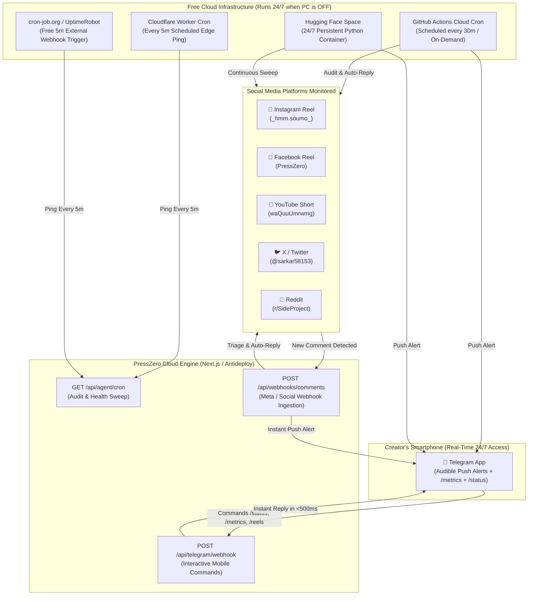

# PressZero 24/7 Autonomous Social Agent — Free Cloud Deployment Guide

> **100% Free • Zero Hosting Costs • PC-Independent • Always-On**

This guide provides the complete blueprint for running the **PressZero 24/7 Autonomous Social Agent** in the cloud continuously, even when your personal computer is turned off, asleep, or disconnected from the internet.

---

## 🏗️ 24/7 Cloud Architecture



---

## 🚀 4 Zero-Cost Ways to Run 24/7 in the Cloud

You can use **any one** of these 100% free options (or combine them for zero downtime redundancy):

### Option 1: GitHub Actions Cloud Runner (Active & Pre-Configured)
* **Cost:** $0.00 / month (Unlimited free minutes for public GitHub repositories).
* **Location:** `.github/workflows/social-agent-247.yml`
* **How it works:** GitHub's cloud runners spin up automatically every 30 minutes in Ubuntu virtual machines, run `autonomous_social_agent.py --cron --live`, triage comments, post replies, dispatch push alerts to Telegram, and commit persistent state back to the repo.
* **Setup:**
  1. Go to your GitHub repository: `https://github.com/soumyadeepsarkar-2004/PressZero/settings/secrets/actions`
  2. Add the following repository secrets:
     - `TELEGRAM_BOT_TOKEN`
     - `TELEGRAM_CHAT_ID`
     - `META_ACCESS_TOKEN` (optional, for Meta Graph API)
     - `TWITTER_BEARER_TOKEN` (optional)
     - `YOUTUBE_API_KEY` (optional)
     - `REDDIT_CLIENT_ID` / `REDDIT_CLIENT_SECRET` (optional)

---

### Option 2: Free Web Cron Pinger via `cron-job.org` (Easiest, 2 Minutes)
* **Cost:** $0.00 / month (Free tier has unlimited crons).
* **Setup:**
  1. Create a free account at [cron-job.org](https://cron-job.org).
  2. Click **Create Cronjob**.
  3. Enter URL:
     ```
     https://presszero.antideploy.app/api/agent/cron?secret=presszero_cron_2026
     ```
  4. Schedule: **Every 5 minutes** (or every 10 minutes).
  5. Save! Now cron-job.org will ping your cloud endpoint 24/7 without your computer on.

---

### Option 3: Cloudflare Worker Cron Dispatcher
* **Cost:** $0.00 / month (Cloudflare Workers Free Tier includes 100,000 requests/day).
* **Location:** `automation/cloudflare-worker/`
* **How it works:** Cloudflare's edge network executes `worker.js` on scheduled crons (`*/5 * * * *`) across hundreds of worldwide data centers.
* **Deploy Command:**
  ```bash
  cd automation/cloudflare-worker
  npx wrangler deploy
  ```

---

### Option 4: Hugging Face Spaces (24/7 Persistent Python Container)
* **Cost:** $0.00 / month (Free CPU tier: 2 vCPUs, 16GB RAM).
* **Location:** `automation/hf-space/`
* **How it works:** Runs a persistent Python process that never sleeps. Continuously audits comments every 60-120 seconds and serves a live web status dashboard on port 7860.
* **Setup:**
  1. Create a free Space on [huggingface.co/spaces](https://huggingface.co/spaces) (Select **Docker** SDK).
  2. Push the files in `automation/hf-space/` to your Space repo.
  3. Set `TELEGRAM_BOT_TOKEN` and `TELEGRAM_CHAT_ID` in Space Settings > Variables and secrets.
  4. Your Space is now online 24/7!

---

## 📱 Mobile Command Center via Telegram Webhook

You can command and query your 24/7 agent right from your smartphone anytime using your Telegram bot:

| Command | Action | Sample Response |
| :--- | :--- | :--- |
| `/status` | Agent health, cloud host, and monitored touchpoints | `🟢 PressZero 24/7 Agent Status: ONLINE. PC Independence: 100%. Cost: $0.00` |
| `/metrics` | Real-time authentic download counter & database sync | `📊 Total Downloads: 12. Compressions: 48. Zero Egress: 184 MB.` |
| `/reels` | Content growth calendar & upcoming video releases | `🎬 Reel 2: Aadhaar Privacy Trap (Nov 8). Reel 3: Otsu Bleach (Nov 15).` |
| `/audit` | Trigger immediate scan across social threads | `🔍 Audit Triggered: All 5 touchpoints clean.` |
| `Any Question` | Context-aware Product Manager response | Direct technical response explaining Wasm bisection or Otsu bleaching |

### Setting Up the Telegram Webhook (One-Time URL Call)
To connect your Telegram bot directly to the live serverless endpoint, open this URL in your web browser:
```
https://api.telegram.org/bot<YOUR_TELEGRAM_BOT_TOKEN>/setWebhook?url=https://presszero.antideploy.app/api/telegram/webhook
```
Telegram will respond with: `{"ok":true,"result":true,"description":"Webhook was set"}`.

---

## 🎬 Content Growth Pipeline (Next 2 Weeks)

The agent maintains scheduled visual video proofs to sustain algorithmic reach:

| Reel # | Scheduled Date | Title & Hook | Video Asset | Status |
| :--- | :--- | :--- | :--- | :--- |
| **Reel 1** | *LIVE* | Never Get Rejected Again - Exact KB Compressor | `public/videos/presszero-promo-vertical.mp4` | 🟢 Published |
| **Reel 2** | Nov 8, 2026 (+7d) | The Aadhaar & Identity Privacy Trap (0-Egress WebAssembly) | `public/videos/presszero-reel2-privacy.mp4` | ✅ Rendered (3.5 MB) |
| **Reel 3** | Nov 15, 2026 (+14d) | Dirty Phone Shadow to 255-Pure White Ink (Otsu Binarization) | `public/videos/presszero-reel3-bleach.mp4` | ✅ Rendered (3.4 MB) |
