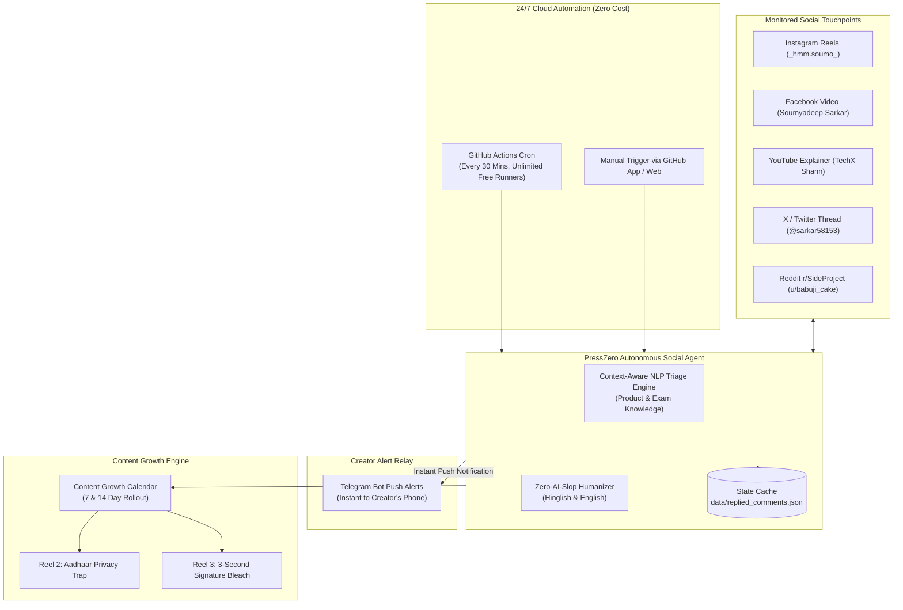

# PressZero 24/7 Autonomous Social Agent & Growth Engine

A continuous, zero-cost, serverless AI community manager and marketing director that runs 24/7 in the cloud—even when your personal PC is powered off.

---

## High-Level Architecture



---

## 1. Zero-Cost 24/7 Cloud Execution (Runs While You Sleep)

### How It Works Without Keeping Your PC On:
- The agent workflow is deployed as a GitHub Actions cron job at [`.github/workflows/social-agent-247.yml`](../.github/workflows/social-agent-247.yml).
- Because `soumyadeepsarkar-2004/PressZero` is a public open-source repository, GitHub provides **unlimited free compute minutes** for scheduled workflows.
- Every 30 minutes, GitHub spawns a cloud runner, executes `scripts/autonomous_social_agent.py --cron --live`, checks for comments across all platforms, posts replies, pings your phone via Telegram, and commits updated interaction states back to the repository.

---

## 2. Instant Telegram Push Notifications Setup (60 Seconds)

Telegram Bot API is **100% free forever** and sends push alerts directly to your phone with zero delay.

### Quick Setup Steps:
1. Open Telegram on your phone or desktop and search for `@BotFather`.
2. Send `/newbot`, choose a name (e.g. `PressZero Community Bot`) and a username (e.g. `presszero_agent_bot`).
3. `@BotFather` will reply with your **Bot Token** (looks like `7829104821:AAFx...`).
4. Now search for `@userinfobot` on Telegram and send `/start` to get your personal **Chat ID** (a number like `123456789`).
5. Add these two secrets to your GitHub Repository:
   - Go to your GitHub Repo -> **Settings** -> **Secrets and variables** -> **Actions** -> **New repository secret**.
   - `TELEGRAM_BOT_TOKEN`: `<your bot token from BotFather>`
   - `TELEGRAM_CHAT_ID`: `<your chat id from userinfobot>`
6. (Optional) For local testing, add them to your local `.env`:
   ```env
   TELEGRAM_BOT_TOKEN="7829104821:AAFx..."
   TELEGRAM_CHAT_ID="123456789"
   ```

### Test Notification:
```powershell
python scripts/autonomous_social_agent.py --test-alert
```

---

## 3. Real-Time Alert Format Received on Your Phone

Whenever anyone comments on any of your launch posts, your Telegram bot instantly pings you with formatted details:

```
🚨 PressZero Community Alert

📍 Platform: 📘 Facebook Video
👤 Author: @Anubhab Mondal
💬 Comment:
"Helpful"

🧠 Triage Intent: GENERAL_APPRECIATION (95%)
⚡ Auto-Reply Dispatched:
"Thanks Anubhab! Glad it's helpful. You can try it directly at https://presszero.antideploy.app (runs 100% locally in your browser with zero server uploads). Let me know if you need any specific portal presets!"

🕒 Timestamp: 01 Nov 2026, 16:34 UTC
🔗 View Live Thread
```

---

## 4. Content Growth Calendar: Upcoming Reels Pipeline

To maintain algorithmic momentum and engagement over time, the agent includes pre-built Remotion video compositions and timed launch milestones:

| Item | Title & Hook | Scheduled | Remotion Composition | Render Command |
|---|---|---|---|---|
| **Reel 1** | *Never Get Rejected Again (Target-KB Bisection)* | **LIVE NOW** | `PressZeroPromo` | `npm run render` (in `promo-video`) |
| **Reel 2** | *The Aadhaar & Identity Privacy Trap (0-Egress)*<br/>**Hook:** *"Stop! That free image compressor just saved your Aadhaar card to an unencrypted cloud server."* | **+7 Days** (Nov 8, 2026) | `PressZeroReel2PrivacyTrap` | `npm run render:reel2` |
| **Reel 3** | *Dirty Phone Shadow to 255-White Ink in 3 Seconds*<br/>**Hook:** *"Why did UPSC and SSC reject your signature again? It wasn't the size. It was this shadow."* | **+14 Days** (Nov 15, 2026) | `PressZeroReel3SignatureBleach` | `npm run render:reel3` |

### Rendering New Reels:
```powershell
cd promo-video
npm run render:reel2   # Outputs out/presszero-reel2-privacy.mp4 (1080x1920)
npm run render:reel3   # Outputs out/presszero-reel3-bleach.mp4 (1080x1920)
```

---

## 5. Local CLI Commands Reference

```powershell
# Run single audit sweep (checks comments, growth schedule, alerts):
python scripts/autonomous_social_agent.py --cron

# Run continuous local monitoring loop (every 60s):
python scripts/autonomous_social_agent.py --poll 60 --live

# Inspect content growth calendar & days remaining:
python scripts/autonomous_social_agent.py --check-growth

# Send test notification to verify Telegram connection:
python scripts/autonomous_social_agent.py --test-alert
```
