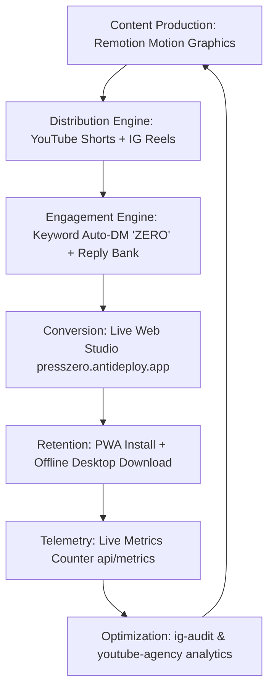

# PressZero Marketing Agency Playbook
**Version 1.0.0 | Full-Funnel Social Growth & Distribution Operating System**

---

## 1. Executive Summary & Brand Positioning

**Brand Name:** PressZero  
**Tagline:** *The Exact Target-KB Image Reducer & Compressor (0 Bytes Egress)*  
**Core Problem Solved:** Every year, 30+ million applicants in India (UPSC, NTA JEE/NEET, SSC CGL, State PSCs, Passport Seva) and worldwide (US Visa DS-160, Schengen Visa) face repeated form upload rejections because their photos or signatures are over the strict 20 KB / 50 KB limit, or have shadowy backgrounds. Traditional online compressors make users guess slider percentages while stealing personal biometric data by uploading photos to remote servers.  
**Core Solution:**
1. **Target-KB Bisection Engine:** Input `20 KB` or `50 KB`, and binary search converges to the exact kilobyte in < 25ms.
2. **AI Signature Bleach:** Converts yellow, shadowy mobile snapshots of signatures to pure 255/255 white parchment.
3. **Biometric Cropper:** Automatic 35×45mm, 350×350px, and 600×600px aspect ratio enforcement.
4. **Verifiable 0 Bytes Egress:** 100% Client-side in-memory Web Worker processing. No photos ever touch a server.

---

## 2. Target Audience Personas

| Persona | Pain Point | Killer Feature | Distribution Channel |
|---|---|---|---|
| **Aspirants (UPSC, NTA, SSC, Banking)** | Forms reject photos >50KB or signatures >20KB repeatedly | Exact 20KB/50KB Presets + Signature Bleach | Instagram Reels, YouTube Shorts, Telegram, Reddit r/UPSC |
| **Visa & Passport Applicants** | US DS-160 strict 600×600 240KB; Schengen 35×45mm | Biometric Aspect Ratio Guard | YouTube Long-form, Google Search, Expats forums |
| **Cybersecurity & Privacy Geeks** | Refuse to upload ID cards / passports to random ad-ridden websites | Zero-knowledge client compute, 0 bytes egress, open-source | X / Twitter threads, Hacker News, Reddit r/webdev |
| **Cyber Cafe & CSC Operators** | Need to resize 50+ candidate documents daily without internet lag | Offline Desktop (.EXE, macOS) & Batch ZIP engine | Facebook Groups, YouTube Tutorials, WhatsApp groups |

---

## 3. Agency Core Deliverables & Workflow

---

## 4. Key Performance Indicators (KPIs)

- **Top-Funnel (Impressions & Reach):** Target 100,000+ views across Instagram Reels & YouTube Shorts in Month 1.
- **Engagement (Save Rate & DM Keywords):** Target > 6% save rate (essential for algorithm recommendation) and 1,500+ `ZERO` comment triggers.
- **Conversion (Web Studio Traffic):** Target 20,000+ monthly active browser sessions on `https://presszero.antideploy.app`.
- **Offline Retention:** Target 3,000+ PWA and desktop installer downloads.
