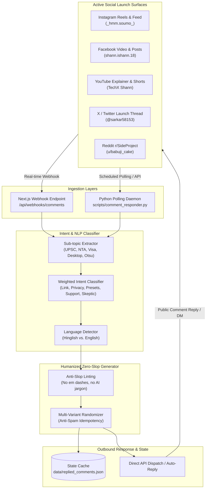

# PressZero Multi-Platform Community & Comment Automation Engine

A high-fidelity, zero-slop automated community responder and webhook engine built to engage, assist, and convert users across **Instagram, Facebook, X (Twitter), YouTube, and Reddit** with 100% contextual accuracy.

---

## Architecture Overview



---

## 1. Intent Taxonomy & Response Specifications

| Category | Typical User Prompts | Core Focus & Resolution | Tone & Platform Guidance |
|---|---|---|---|
| **LINK_REQUEST** | *"Link please", "Website name?", "Free hai kya?", "Where to download?"* | Direct link to `https://presszero.antideploy.app`, zero sign-up, 100% free & open-source, no watermarks. | Warm, welcoming, immediate link delivery. |
| **PRIVACY_SECURITY** | *"Is it safe to upload Aadhaar/Passport?", "Where is data stored?", "Data leak risk?"* | Proof of 0 Bytes Egress, pure client-side WebAssembly RAM execution, zero server uploads, airplane-mode verifiability. | Reassuring, technically precise, authoritative. |
| **EXAM_PRESET** | *"UPSC signature KB?", "NTA NEET photo date/size?", "US Visa 600x600?"* | Exact specifications (UPSC 10-20KB signature, NTA 50-200KB photo, US Visa 240KB 1:1) and preset walkthrough. | Informative, direct, solves exam panic instantly. |
| **TROUBLESHOOTING** | *"Signature faint", "Background dark gray", "Desktop offline version?"* | Otsu binarization, paper cutoff slider instructions, Windows `.exe` / macOS `.zip` offline installer links. | Helpful, clear step-by-step guidance. |
| **SKEPTIC_OBJECTION** | *"Already TinyPNG/iLoveIMG exists", "Why bother?", "What's new?"* | Binary search target-KB bisection vs guessing percentage sliders, 0-byte server egress privacy vs cloud uploads. | Confident, polite, data-backed comparison. |
| **APPRECIATION** | *"Awesome tool!", "OP bhai", "Very helpful, thanks!"* | Sincere gratitude, prompt to star GitHub repository or share with exam aspirants. | Friendly, community-oriented. |

---

## 2. Platform Endpoints & Verified Target Surfaces

1. **Reddit**:
   - Subreddit: `r/SideProject` (348K weekly active visitors)
   - Submission URL: `https://www.reddit.com/r/SideProject/comments/1xl2d7c/presszero_i_built_an_opensource_100_inbrowser/`
   - Post ID: `1xl2d7c`
   - Author: `u/babuji_cake`

2. **Instagram**:
   - Reel URL: `https://www.instagram.com/_hmm.soumo_/reel/DfMxAKRKGtg/`
   - Profile: `_hmm.soumo_`
   - Media Shortcode: `DfMxAKRKGtg`

3. **YouTube**:
   - Explainer Video: `https://www.youtube.com/watch?v=waQuuUmrwmg`
   - Channel: `TechX Shann`
   - Video ID: `waQuuUmrwmg`

4. **X (Twitter)**:
   - Viral Tweet: `https://x.com/sarkar58153/status/2116815001730343100`
   - Launch Thread: `https://x.com/sarkar58153/status/2116808835906334807`
   - Handle: `@sarkar58153`

5. **Facebook**:
   - Video / Reel: `https://www.facebook.com/shann.ishann.18`
   - Profile: `Soumyadeep Sarkar`

---

## 3. CLI Operation & Usage

The automation suite is located at `scripts/comment_responder.py` and integrated into `scripts/publish_all.py`.

### Benchmark Simulation (Tests 10 Real Scenarios)
```powershell
python scripts/comment_responder.py --simulate-batch
```

### Live Polling Mode (Continuous Monitoring every 60s)
```powershell
python scripts/comment_responder.py --poll 60 --live
```

### Interactive Classification Tester
Test any custom comment text to verify intent detection and generated response:
```powershell
python scripts/comment_responder.py --interactive
```

### Reset State History
To clear the replied comments idempotency cache (`data/replied_comments.json`):
```powershell
python scripts/comment_responder.py --reset-state
```

### Unified Social Orchestrator
To run comments automation as part of the unified publisher workflow:
```powershell
python scripts/publish_all.py --comments
```

---

## 4. Next.js Webhook Integration (`/api/webhooks/comments`)

The application exposes a production-ready Next.js Route Handler at `src/app/api/webhooks/comments/route.ts`.

### Meta Graph API Webhook Handshake (GET)
When configuring the Instagram/Facebook webhook in Meta App Dashboard:
- **Callback URL**: `https://presszero.antideploy.app/api/webhooks/comments`
- **Verify Token**: Set `META_WEBHOOK_VERIFY_TOKEN` (default: `presszero_meta_verify_2026`)

### Ingestion & Auto-Reply (POST)
Accepts standard Meta Webhook payloads or custom community JSON payloads:
```bash
curl -X POST https://presszero.antideploy.app/api/webhooks/comments \
  -H "Content-Type: application/json" \
  -d '{
    "platform": "instagram",
    "user": "exam_student",
    "comment": "UPSC ke liye signature kitne kb ka hona chahiye?",
    "id": "cmt_1001"
  }'
```

Response:
```json
{
  "success": true,
  "platform": "instagram",
  "commentId": "cmt_1001",
  "sender": "exam_student",
  "query": "UPSC ke liye signature kitne kb ka hona chahiye?",
  "intent": "EXAM_PRESET",
  "confidence": 0.95,
  "language": "hinglish",
  "subTopic": "upsc",
  "reply": "UPSC ke liye signature 10-20 KB aur photo 20-50 KB chahiye hoti hai. PressZero Studio me direct UPSC preset select karo ya target me '18 KB' likh do, exact lock kar dega!",
  "liveDispatched": false,
  "timestamp": "2026-11-01T13:10:00.000Z"
}
```

---

## 5. Environment Variables Configuration

Set these variables in your deployment environment or `.env.local`:

```env
# Meta Graph API (Instagram & Facebook)
META_ACCESS_TOKEN="EAA..."
META_WEBHOOK_VERIFY_TOKEN="presszero_meta_verify_2026"
INSTAGRAM_MEDIA_ID="18023948291..."

# X (Twitter) API v2
TWITTER_BEARER_TOKEN="AAAA..."
TWITTER_API_KEY="..."
TWITTER_API_SECRET="..."
TWITTER_ACCESS_TOKEN="..."
TWITTER_ACCESS_SECRET="..."

# YouTube Data API v3
YOUTUBE_API_KEY="AIzaSy..."

# Reddit API (Optional for OAuth Post)
REDDIT_CLIENT_ID="..."
REDDIT_CLIENT_SECRET="..."
REDDIT_USERNAME="babuji_cake"
REDDIT_PASSWORD="..."
```

---

## 6. Zero-AI-Slop & Human Quality Standards

Every generated response is strictly filtered against AI boilerplate:
- **No Em Dashes (`—`)**: Natural punctuation (hyphens `-`, commas `,`, and full stops `.`) are enforced.
- **No Robotic Buzzwords**: Avoids words like `delve`, `testament`, `tapestry`, `game changer`, `revolutionary`, `seamless`.
- **Language Matching**: Hindi/Hinglish queries receive native, respectful Hinglish replies. English queries receive clear, friendly English replies.
- **Idempotency Guarantee**: Checked against `data/replied_comments.json` prior to any response dispatch, eliminating double-replies or automated spam flags.
